# ShopFloor AI

**Schicht- und Personalplanung in der Fertigung: Die KI schlägt vor, deterministischer Code prüft, der Mensch entscheidet.**

Web-Anwendung für die Wochenplanung von Fertigungszellen und für die schnelle Suche nach Ersatz bei Ausfällen. Entwickelt von Sezer Tig als Einzelprojekt, gebaut mit Claude Code als Entwicklungspartner. Dieses Repository ist ein **Schaufenster**: Es zeigt Problem, Vorgehen, Ergebnis, Screenshots und einen kleinen Code-Auszug. Der vollständige Quellcode ist privat.

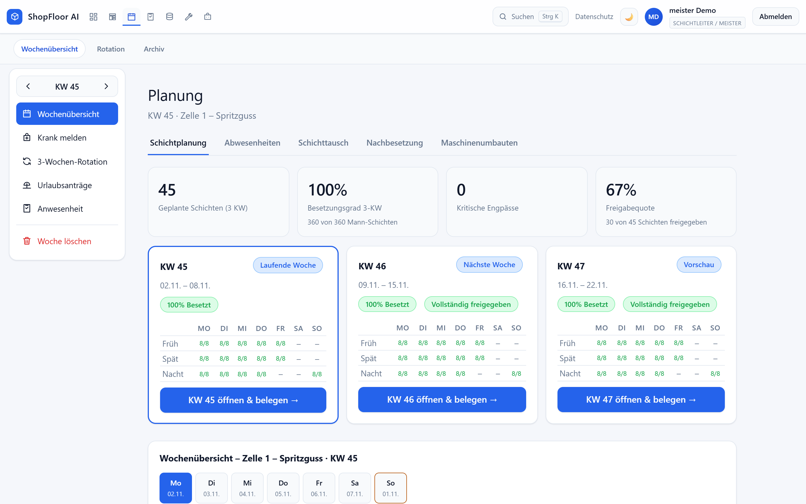

## Das Problem

Die Abteilungsleitung eines Fertigungsunternehmens fragte, ob sich die Schichtplanung besser lösen lässt. Eine Wochenplanung muss gleichzeitig beachten:

- **Qualifikation und Maschinenfreigabe** (wer darf welche Maschine bedienen),
- **Ruhezeit** von 11 Stunden zwischen zwei Schichten und die **Wochenarbeitszeit**,
- eine feste **Schichtfolge** (Früh, Nacht, Spät) und höchstens 5 Nachtschichten in Folge,
- **Mindestbesetzung** je Zelle und Schicht, Urlaub, Krankheit und Maschinenumbauten.

Fällt kurzfristig jemand aus, muss in kurzer Zeit eine Person gefunden werden, die passt und keine Regel verletzt. Das ist aufwendig und fehleranfällig.

## Der Ansatz

**Die KI plant nicht allein.** Ich habe die Aufgaben bewusst getrennt:

| Aufgabe | Wer macht es |
|---|---|
| Planvorschlag und Ersatzvarianten berechnen | regelbasierter Planer (Code, ohne Sprachmodell) |
| Jeden Vorschlag gegen die harten Regeln prüfen | deterministische Regelengine mit Klartext-Begründung |
| Absicht einer Chat-Anfrage erkennen („Gesa Christ ist krank, bitte Ersatz“) | Sprachmodell, nur die Absicht |
| Antworten und Ergebnisse darstellen | die App, deterministisch |
| Entscheidung und Freigabe | **immer ein Mensch** (ein Klick vor jedem Schreibzugriff) |

So bleibt jede Planung nachvollziehbar, und ein Fehler des Modells kann keine regelwidrige Besetzung auslösen.

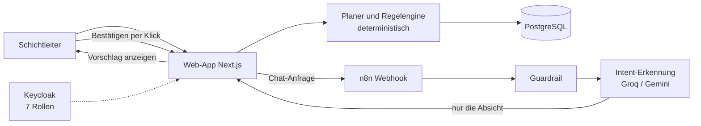

## Was dabei entstanden ist

| Ersatzvarianten bei Ausfall | Besetzung mit Regelprüfung |
|---|---|
| 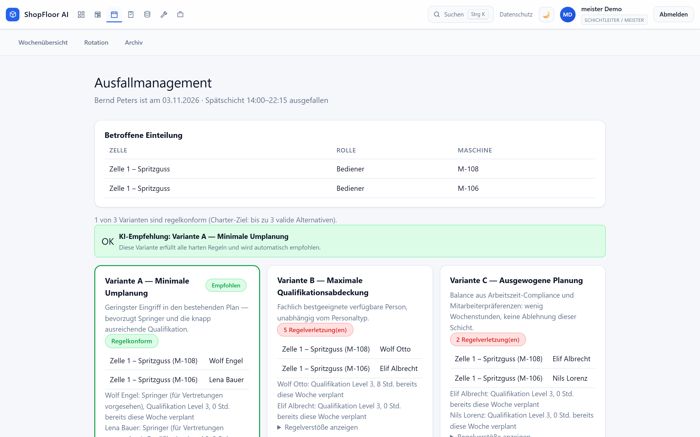 | 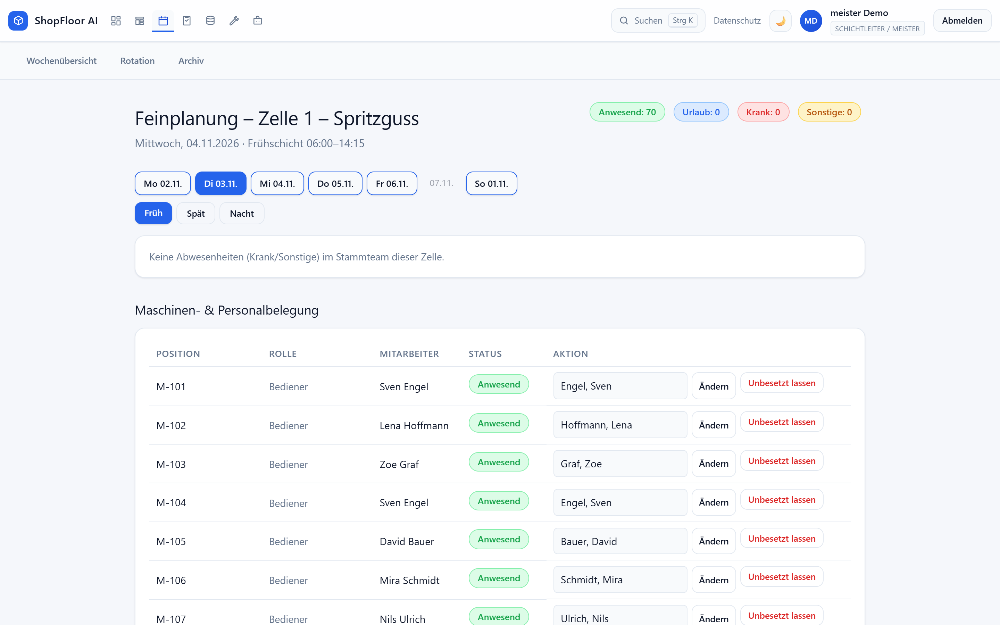 |

- **Planvorschlag** je Schicht und Zelle mit drei Strategien (Zufriedenheit, Qualifikation, wenig Überstunden).
- **7 harte Regeln:** Verfügbarkeit, Qualifikation, Maschinenfreigabe, Ruhezeit und Arbeitszeit, Mindestbesetzung, Doppelbelegung, Sperrregeln.
- **Ausfallmanagement:** bis zu 3 Ersatzvarianten (minimale Umplanung, maximale Qualifikation, ausgewogen). Verletzt eine Variante eine Regel, wird sie markiert und nicht empfohlen.
- **3-Wochen-Rotation** mit festen Teams, Freigabe je Schicht, Wochen-Ampel für Krank und Urlaub, Umbau mitten in der Schicht.
- **Anwesenheit** mit Tagesliste, Abschließen und Fehlzeiten-Auswertung, dazu ein **Live-Board** für die Lage der Zellen.
- **KI-Assistent** für Fragen und Navigation per Sprache, abgesichert durch eine Guardrail.
- **Sicherheit und Datenschutz:** Rollen über Keycloak, Audit-Log, DSGVO-Löschfristen, verschlüsselte Backups.

| Live-Board | Anwesenheit |
|---|---|
| 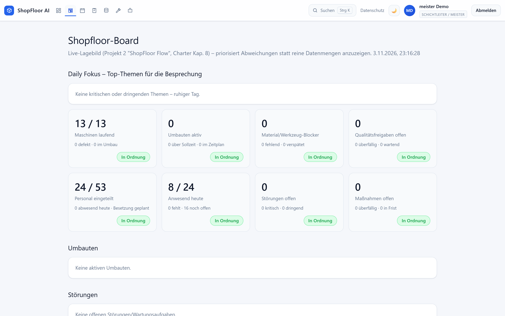 | 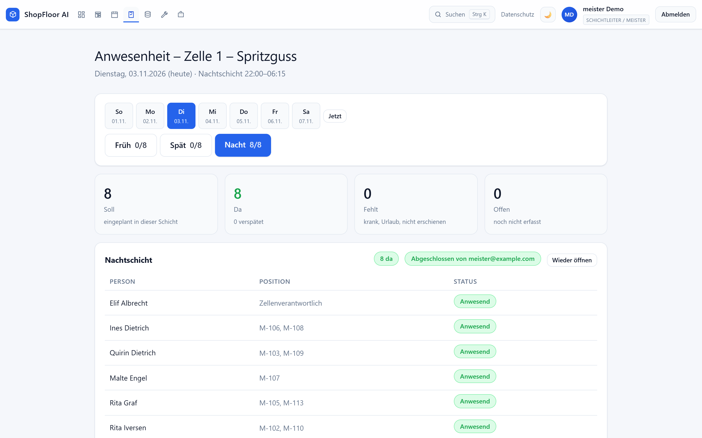 |

| Rotation | KI-Assistent |
|---|---|
| 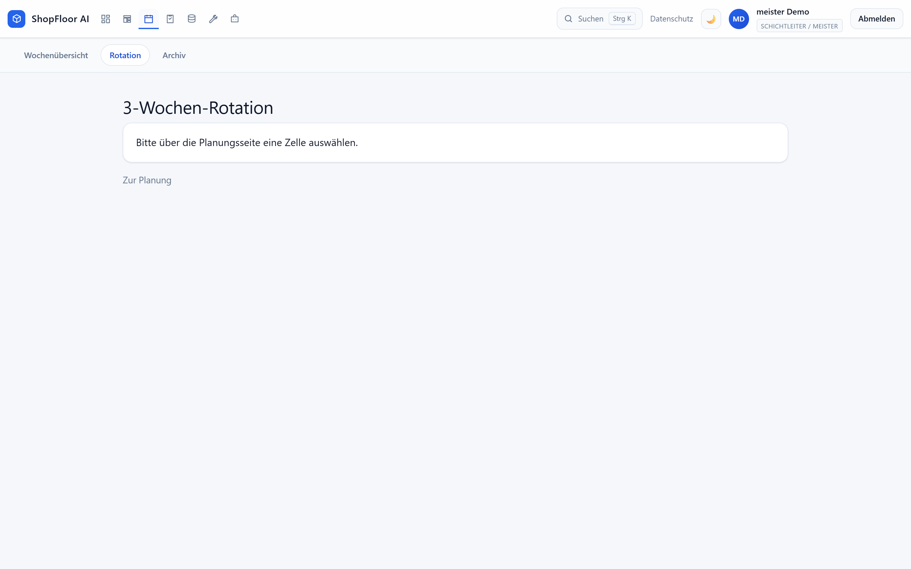 | 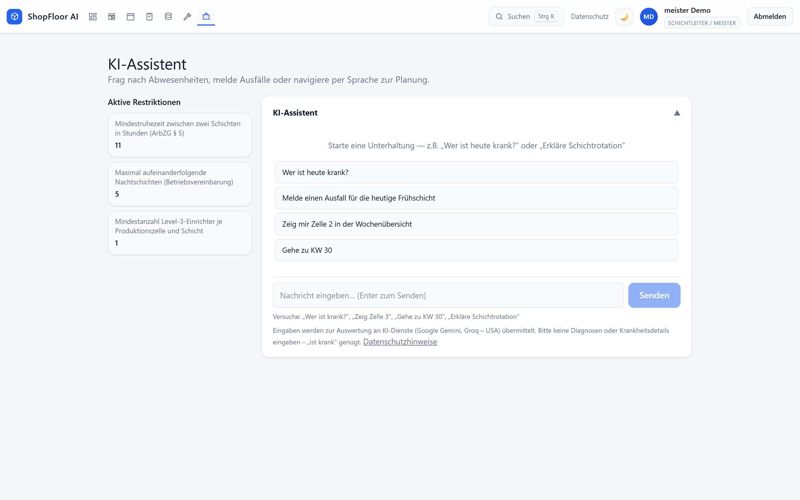 |

### Bedienung

Schnellnavigation per **Strg+K**, helles und dunkles Theme, durchgängiger Tastaturfokus und eine Ansicht für Tablet und Handy.

| Schnellnavigation | Dunkles Theme |
|---|---|
| 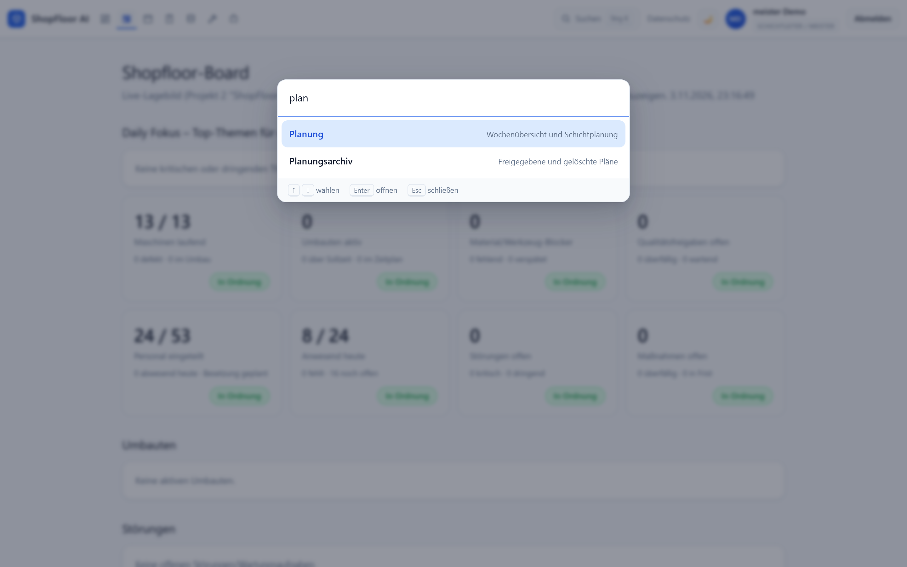 | 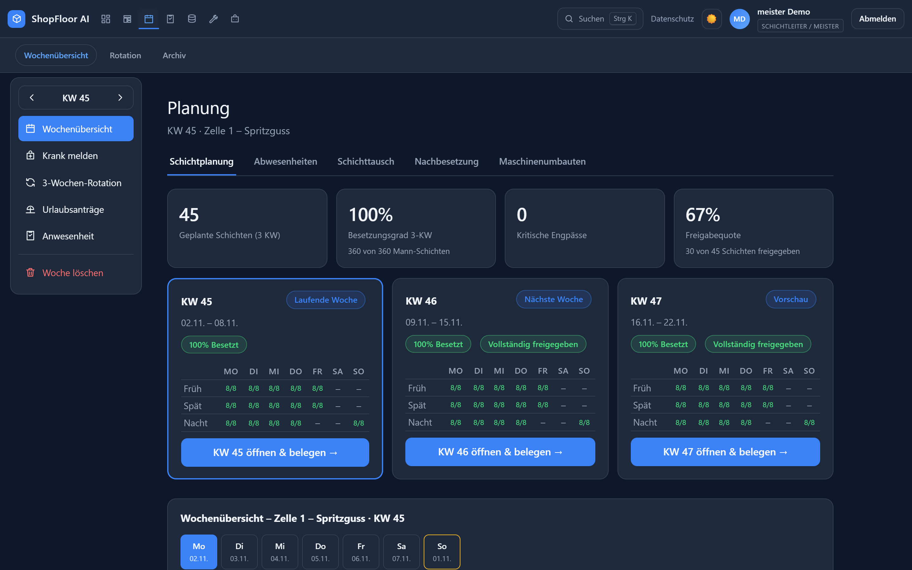 |

| Anmeldung | Handy |
|---|---|
| 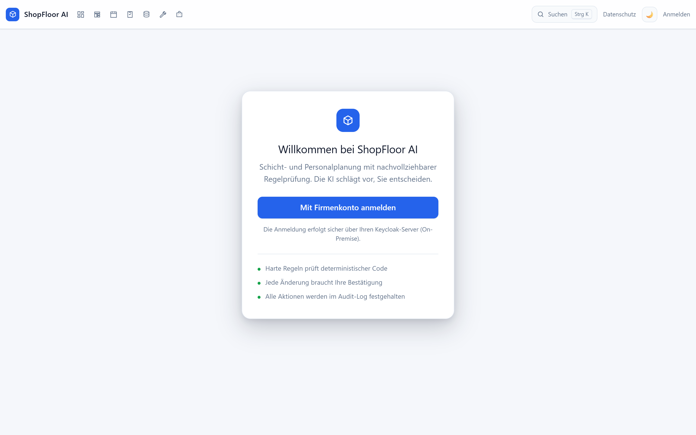 | 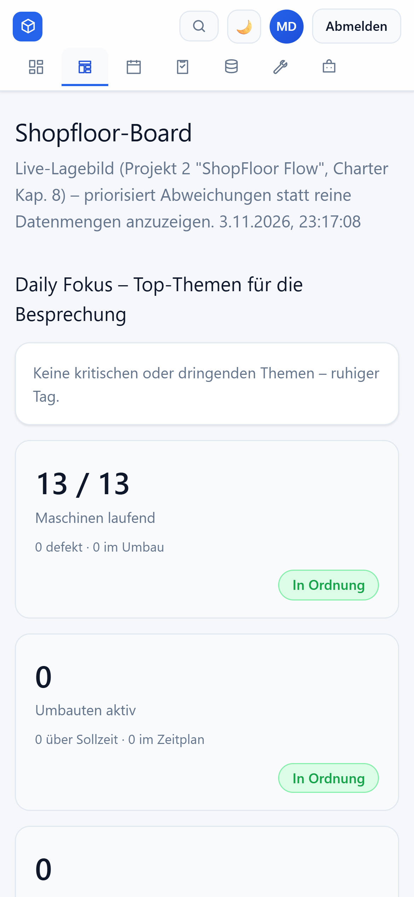 |

## Wie ich vorgegangen bin

1. **Fachregeln zuerst:** Schichtmodell, Ruhezeit, Wochenstunden und Rotation als Code mit Tests festgelegt, bevor ein Sprachmodell ins Spiel kam.
2. **KI nur dort, wo sie hilft:** Absichtserkennung im Chat. Alles Entscheidende ist deterministisch und erklärbar.
3. **Mit KI entwickelt, selbst verantwortet:** Claude Code hat Code geschrieben und geprüft. Architektur, Regeln, Testfälle und Abnahme habe ich vorgegeben und kontrolliert.
4. **Absichern und testen:** Guardrails gegen Missbrauch, Audit-Log, Rollenmodell, automatische und manuelle Tests.

## Qualität

- **40 automatische Tests** (Vitest): Schichtzeiten, Arbeitswoche, Planer sowie die Regeln Ruhezeit, Rotation, Wochenstunden und Nachtschichtfolge. Siehe [code-auszug](code-auszug).
- **21 manuelle Testfälle** in vier Dimensionen (Korrektheit, Relevanz, Vollständigkeit, Sicherheit): 19 vollständig bestanden, 2 mit Vorbehalt (Antwortzeit des externen KI-Dienstes im kostenlosen Tarif, Agentenpfad nur 4 von 5 Läufen korrekt).
- Daten: 4 Zellen, 38 Maschinen, 248 **synthetische** Mitarbeitende. Es werden keine echten Personendaten verwendet.

## Ehrliche Grenzen

- **Keine Messung der Zeitersparnis.** Die Funktionen sind umgesetzt, die Zielwerte (kürzere Planungszeit, schneller Ersatz) aber nicht in einem Pilotbetrieb gemessen. Beobachtet wurde in einem Einzelfall eine Ersatzvorschlag-Antwort nach etwa zwei Sekunden.
- **Kein Echtbetrieb.** Dafür fehlen Betriebsrat, Datenschutz-Folgenabschätzung, die formale Einstufung nach EU-KI-Verordnung (Art. 6 Abs. 3) sowie Auftragsverarbeitung und Drittlandtransfer. Das sind organisatorische Schritte, keine Codefragen.
- **Kostenlose KI-Kontingente** der Anbieter begrenzen Antwortzeit und Anzahl der Anfragen.
- Schichtzeiten und Wochengrenze sind im Code fest und noch nicht konfigurierbar.

## Technik

Next.js 14 (App Router), React 18, TypeScript, Tailwind 4, PostgreSQL 16 (ohne ORM), Keycloak, n8n, Groq und Google Gemini, Vitest, Docker.

## Code und Lizenz

Ein kleiner Auszug mit der Regelprüfung und den Tests steht im Ordner [code-auszug](code-auszug). Der vollständige Quellcode ist privat und kann in einem Gespräch gezeigt werden. Alle Rechte vorbehalten, siehe [LICENSE.md](LICENSE.md).
